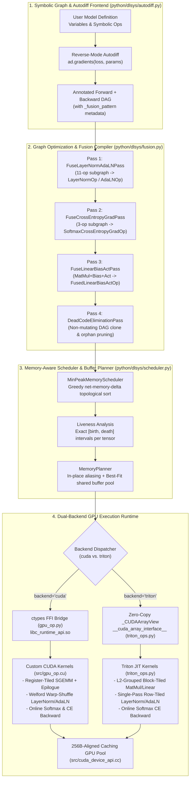

# TinyFlow: Deep Learning Graph Compiler, Memory-Aware Scheduler & Custom CUDA/Triton Kernel Engine

## 1. Executive Summary & System Architecture

**TinyFlow** (`TinyFlow/`) is an end-to-end symbolic deep learning compiler, automatic differentiation engine, and high-performance GPU runtime written in Python, C++, CUDA, and OpenAI Triton. Starting from a declarative computation graph API modeled after early TVM/MXNet (`dlsys`), TinyFlow compiles symbolic forward and backward dataflow graphs through a multi-pass optimization pipeline into memory-planned execution schedules backed by custom register-tiled CUDA and block-tiled Triton kernels.

### Key Architectural Highlights & Empirical Outcomes
- **Multi-Pass Operator Fusion (`fusion.py`)**: Automatically detects and fuses multi-operator subgraphs—including `MatMul + Bias + ReLU/GELU`, 11-operator decomposed `LayerNorm` and `AdaLN` (Adaptive Layer Normalization for Diffusion Transformers) forward/backward subgraphs, and `SoftmaxCrossEntropy` backward subgraphs—reducing end-to-end training graph node count from **73 $\rightarrow$ 32 nodes (56.2% reduction)**.
- **Memory-Aware Topological Scheduling & Static Buffer Sharing (`scheduler.py`)**: Combines a greedy min-peak-memory topological scheduler (`MinPeakMemoryScheduler`) with liveness-interval buffer reuse and in-place operator aliasing (`MemoryPlanner`), reducing intermediate activation memory from **22,926.5 KB $\rightarrow$ 4,230.5 KB (5.42$\times$ reduction)** by packing 32 intermediate tensors into **16 shared physical GPU buffers**.
- **256-Byte Aligned Caching GPU Allocator (`cuda_device_api.cc`)**: Replaces synchronous per-tensor `cudaMalloc`/`cudaFree` driver calls with a best-fit `std::multimap` free-block pool, achieving a **99% cache hit rate** (1 driver `cudaMalloc` across 100 ephemeral allocations) and eliminating host-device synchronization stalls.
- **Custom CUDA & Triton Kernels (`gpu_op.cu`, `triton_ops.py`)**:
  - **SGEMM Hierarchy**: Progresses from Naive CUDA (**3.08 TFLOPS**) $\rightarrow$ 2D Shared-Memory Tiled CUDA (**3.76 TFLOPS**) $\rightarrow$ 64$\times$64 Block / 4$\times$4 Register-Tiled CUDA (**9.18 TFLOPS**, **2.98$\times$ over Naive**) $\rightarrow$ L2-Grouped Block-Tiled Triton (**16.32 TFLOPS**, **99.1% of cuBLAS** at 16.47 TFLOPS).
  - **Fused Epilogue & Normalization Kernels**: Single-launch Welford warp-shuffle `LayerNorm` (**0.009 ms**) and `AdaLN`, online safe-softmax cross-entropy backward, and fused `Linear+Bias+GELU` (**1.63$\times$ speedup** over unfused kernels), delivering a **1.78$\times$ end-to-end training step speedup** (**0.593 ms $\rightarrow$ 0.333 ms**).

---

### 1.1 End-to-End Architecture Diagram




### 1.2 Layered Software Stack & Zero-Copy ABI

```
+-----------------------------------------------------------------------------------+
| Python Compiler & Execution Layer (TinyFlow/python/dlsys/)                        |
|                                                                                   |
|  +--------------------+   +-----------------------+   +------------------------+  |
|  | autodiff.py        |   | fusion.py             |   | scheduler.py           |  |
|  | - Node / Op DAG    |-->| - PassManager         |-->| - MinPeakMemorySched   |  |
|  | - Reverse-Mode AD  |   | - Subgraph Rewriters  |   | - Liveness Intervals   |  |
|  | - Executor         |   | - Non-mutating Clone  |   | - Best-Fit Buffer Pool |  |
|  +--------------------+   +-----------------------+   +-----------+------------+  |
|                                                                   |               |
|  +------------------------------------+   +-----------------------v------------+  |
|  | triton_ops.py                      |   | ndarray.py & gpu_op.py             |  |
|  | - _CUDAArrayView (zero-copy ptr)   |<--| - DLArray / DLContext ctypes ABI   |  |
|  | - @triton.jit kernels              |   | - Kernel launch telemetry          |  |
|  +-----------------+------------------+   +-----------------------+------------+  |
+--------------------|----------------------------------------------|---------------+
                     | Raw Device Pointer (uint64)                  | ctypes CDLL
+--------------------v----------------------------------------------v---------------+
| C++11 / CUDA 12 Runtime Engine (TinyFlow/src/ -> build/lib/libc_runtime_api.so)   |
|                                                                                   |
|  +------------------------------------+   +------------------------------------+  |
|  | cuda_device_api.cc                 |   | gpu_op.cu                          |  |
|  | - 256B-Aligned Caching Allocator   |   | - Tier 1/2/3 SGEMM & FusedLinear   |  |
|  | - Multimap Free Bins & OOM Retry   |   | - Warp-Shuffle Reductions & Welford|  |
|  | - Active / Peak / Hit Telemetry    |   | - LayerNorm, AdaLN, GELU, Softmax  |  |
|  +------------------------------------+   +------------------------------------+  |
+-----------------------------------------------------------------------------------+
```

---

## 2. Symbolic Computation Graph, Reverse-Mode AD & Operator Fusion Compiler

### 2.1 Reverse-Mode Automatic Differentiation (`autodiff.py`)

In TinyFlow, every computation is represented as a `Node` in a symbolic Directed Acyclic Graph (DAG), where `node.op` is a singleton `Op` instance and `node.inputs` holds predecessor nodes.

Given an output loss node $L$ and target parameter nodes $\{W_1, \dots, W_k\}$, `ad.gradients(output_node, node_list)` constructs the backward adjoint graph symbolically:
1. Initialize a mapping `node_to_output_grads_list` with $\bar{L} = [\mathbf{1}_L]$.
2. Traverse the forward graph in **reverse topological order** ($u \in \text{reversed}(\text{topo\_order})$).
3. Aggregate incoming partial adjoints into a single adjoint node without executing any eager ops:
   $$\bar{u} = \sum_{v \in \text{consumers}(u)} \frac{\partial L}{\partial v} \frac{\partial v}{\partial u}$$
4. Invoke `u.op.gradient(u, grad_u)` to emit symbolic backward `Node`s for each input $v_i \in u.\text{inputs}$ and append them to `node_to_output_grads_list[v_i]`.

#### Eliminating Hidden Host-Device Synchronizations in Backward Reductions
A critical subtle bottleneck in naive symbolic engines is inspecting tensor shapes dynamically during `compute()`. When a bias vector $b \in \mathbb{R}^{N}$ is broadcast to $B \in \mathbb{R}^{M \times N}$ via `BroadcastToOp(b, shape_ref)`, its backward operator `ReduceSumAxisZeroOp` reduces across leading dimensions. Rather than calling `.asnumpy()` on a shape tensor (which triggers a synchronous `cudaMemcpy(..., cudaMemcpyDeviceToHost)` that stalls the entire CUDA stream every step), TinyFlow reads `input_vals[0].shape` directly from host-resident `DLArray.shape` metadata and launches `gpu_op.reduce_sum_axis_zero` asynchronously.

---

### 2.2 Dual-Representation Composite Subgraphs & Multi-Pass Operator Fusion (`fusion.py`)

High-level normalization primitives (`layernorm_op` and `adaln_op`) can be executed in two ways:
1. **Unfused Decomposed Subgraph (11 primitive ops)**: Necessary for testing baseline execution and symbolic differentiation through elementary operations (`ReduceMeanAxisOne`, `Sub`, `Mul`, `Sqrt`, `Div`, `BroadcastTo`, `Add`).
2. **Whole-Subgraph Fused Kernel (1 op)**: Collapses all 11 forward ops into a single Welford warp-shuffle kernel (`LayerNormOp` / `AdaLNOp`) and the ~20 decomposed backward ops into a single `LayerNormGradientOp` / `AdaLNGradientOp` plus two parameter reductions.

To support both seamlessly while keeping `ad.gradients()` purely symbolic, composite builders attach a `_fusion_pattern` dictionary to the root output node of the decomposed subgraph. When `Executor(..., enable_fusion=True)` runs, `PassManager` executes four ordered graph-rewriting passes via a **non-mutating bottom-up DAG cloner** (`_clone_rewritten_dag`) so the caller's original unfused graph remains untouched for baseline comparisons:

```
Unfused MLP + LayerNorm Training DAG (73 Nodes)
===============================================

   [X]   [W1]
     \   /
    MatMulOp       [b1]
       \           /
        \    BroadcastToOp
         \       /
          AddOp
            |
   +--------+----------------------------------------------------+
   | Decomposed LayerNorm Forward Subgraph (11 Primitive Nodes)  |
   |  mean = ReduceMeanAxisOne(h) -> BroadcastTo                 |
   |  xc   = Sub(h, mean) -> Mul(xc, xc) -> ReduceMeanAxisOne    |
   |  rstd = Div(OnesLike, Sqrt(AddConst(var, eps)))             |
   |  xhat = Mul(xc, BroadcastTo(rstd))                          |
   |  ln   = Add(Mul(xhat, BroadcastTo(gamma)), BroadcastTo(beta)|
   +--------+----------------------------------------------------+
            |
          GeluOp   [W2]
             \     /
             MatMulOp     [b2]
                 \         /
                  \  BroadcastToOp
                   \     /
                    AddOp          [Y]
                      \            /
                 SoftmaxCrossEntropyOp (Loss)
                            |
           +----------------+----------------+
           | Unfused Backward AD (48 Nodes)  |
           +---------------------------------+

                         |
                         |  PassManager (4 Compiler Passes)
                         v

Fused & DCE-Pruned Training DAG (32 Nodes — 56.2% Fewer Nodes)
==============================================================

   [X]   [W1]   [b1]
     \    |     /
   FusedLinearBiasActOp (act="none")
          |
     LayerNormOp (1 Welford CUDA/Triton Kernel replaces 11 nodes)
          |
       GeluOp    [W2]   [b2]
          \       |     /
        FusedLinearBiasActOp (act="none")   [Y]
                  \                         /
                SoftmaxCrossEntropyOp (Loss)
                          |
         +----------------+----------------+
         | Fused Backward AD:              |
         | - SoftmaxCrossEntropyGradOp     |
         | - LayerNormGradientOp (dx,dg,db)|
         +---------------------------------+
```

#### Compiler Pass Summary (`PassManager`)

| Pass Order | Compiler Pass | Pattern Matched | Replacement Op(s) | Kernel Launches Saved |
| :---: | :--- | :--- | :--- | :---: |
| **1** | `FuseLayerNormAdaLNPass` | 11-op forward & ~20-op backward subgraphs tagged with `_fusion_pattern` (`layernorm`, `adaln`) | `LayerNormOp`, `LayerNormGradientOp`, `AdaLNOp`, `AdaLNGradientOp` | **10 forward + ~17 backward** per norm layer |
| **2** | `FuseCrossEntropyGradPass` | `MulOp(SubOp(SoftmaxOp(Z), Y), dL)` | `SoftmaxCrossEntropyGradOp(Z, Y, dL)` | **2 launches** + 2 intermediate `(M, N)` buffers |
| **3** | `FuseLinearBiasActPass` | `ActOp(AddOp(MatMulOp(X, W), BroadcastToOp(b)))` or `AddOp(MatMulOp(X, W), BroadcastToOp(b))` | `FusedLinearBiasActOp(X, W, b, act_type)` | **2–3 launches** + eliminates DRAM write/read of pre-bias & pre-act tensors |
| **4** | `DeadCodeEliminationPass` | Bottom-up reachability traversal from `eval_node_list` | Prunes orphaned intermediate subgraph nodes | Zero dead kernel launches or buffer allocations |

```python
# Non-mutating bottom-up DAG rewrite (TinyFlow/python/dlsys/fusion.py)
def _clone_rewritten_dag(eval_node_list, replacements):
    memo = {}
    def resolve(node):
        while node in replacements and replacements[node] is not node:
            node = replacements[node]
        if node in memo:
            return memo[node]
        new_inputs = [resolve(inp) for inp in node.inputs]
        if any(ni is not oi for ni, oi in zip(new_inputs, node.inputs)):
            cloned = copy.copy(node)
            cloned.inputs = new_inputs
            if hasattr(node, "_fusion_pattern") and isinstance(node._fusion_pattern, dict):
                fp = dict(node._fusion_pattern)
                for k, v in list(fp.items()):
                    if isinstance(v, ad.Node):
                        fp[k] = resolve(v)
                cloned._fusion_pattern = fp
            memo[node] = cloned
            return cloned
        memo[node] = node
        return node
    return [resolve(n) for n in eval_node_list]
```

---

## 3. Memory-Aware Graph Scheduling, Static Buffer Pool & Caching GPU Allocator

### 3.1 Problem Formulation: Peak Live Activation Memory

A naive graph executor (`find_topo_sort` via Depth-First Search) allocates a dedicated persistent `NDArray` for every node in the DAG and never reclaims intermediate buffers within an iteration. For a graph $G = (V, E)$, total memory under naive allocation equals the sum of all intermediate tensor sizes $\sum_{v \in V} S(v)$.

In contrast, if an intermediate tensor $v$'s memory is released immediately after its last consumer finishes executing, the **instantaneous live memory** $M(t)$ at step $t \in \{0, \dots, |V|-1\}$ of a topological schedule $\pi$ is driven by the net memory delta $\Delta M(u)$ of executing node $u = \pi(t)$:

$$\Delta M(u) = S(u) - \sum_{\substack{v \in \text{inputs}(u) \\ \text{rem\_consumers}(v) = 1 \\ v \notin V_{\text{feed}} \cup V_{\text{out}}}} S(v)$$

where $S(v) = 4 \prod_{d} \text{shape}(v)_d$ bytes (FP32) and $\text{rem\_consumers}(v) = 1$ means $u$ is the **final remaining consumer** of $v$, allowing $v$'s physical buffer to be freed or recycled immediately after step $t$.

### 3.2 Algorithm 1: Greedy Min-Peak-Memory Topological Scheduler (`MinPeakMemoryScheduler`)

Located in `TinyFlow/python/dlsys/scheduler.py`, `MinPeakMemoryScheduler.schedule()` maintains the set of ready nodes $R = \{u \in V \mid \text{in\_degree}(u) = 0\}$ and iteratively selects the ready node minimizing a lexicographic priority tuple:

$$\text{priority}(u) = \Big(\Delta M(u),\; -\big|\{v \in \text{inputs}(u) \mid \text{rem\_consumers}(v) = 1\}\big|,\; \text{dfs\_rank}(u)\Big)$$

1. **Primary key ($\Delta M(u)$)**: Prioritizes consumer nodes that immediately free large predecessor activations over producer nodes that allocate new branches.
2. **Secondary key ($-\text{freed\_count}(u)$)**: Breaks ties in favor of nodes that retire the largest number of live input tensors.
3. **Tertiary key ($\text{dfs\_rank}(u)$)**: Preserves locality along deep chains when memory deltas are equal.

### 3.3 Algorithm 2: Liveness-Interval Static Buffer Sharing & In-Place Aliasing (`MemoryPlanner`)

Once `MinPeakMemoryScheduler` fixes the execution order $\pi = [v_0, v_1, \dots, v_{T-1}]$ and `infer_shape` computes static tensor shapes, `MemoryPlanner.plan()` performs a two-stage static storage optimization:

1. **Exact Liveness Interval Analysis (`compute_liveness_intervals`)**:
   For each node $v_t$ executed at step $t$:
   - $\text{birth}(v_t) = t$
   - $\text{death}(v_t) = \max\big(\{t\} \cup \{t' > t \mid v_t \in \text{inputs}(v_{t'})\}\big)$ (or $\infty$ if $v_t \in V_{\text{feed}} \cup V_{\text{out}}$).
2. **Buffer Allocation & Reuse Pool**:
   - **In-Place Unary Aliasing**: If `enable_inplace=True` and $v_t.\text{op}$ is a safe elementwise unary op (`ReluOp`, `GeluOp`, `MulByConstOp`, `AddByConstOp`) whose input $x = v_t.\text{inputs}[0]$ dies at step $t$ ($\text{death}(x) = t$) and has identical shape, $v_t$ aliases $x$'s physical `NDArray` directly (zero memory overhead, in-place kernel execution).
   - **Best-Fit Shared Buffer Pool**: Otherwise, the planner searches the pool of currently inactive buffers (`free_buffers`) for the smallest buffer satisfying $B.\text{nbytes} \in [S(v_t),\; 2 \cdot S(v_t)]$. If found, `ndarray.NDArray.view(shape)` creates a zero-copy typed header pointing to the same device pointer `B.handle.contents.data`. When $\text{step} = \text{death}(v)$, $v$'s buffer is returned to `free_buffers` for subsequent steps.

```
Liveness-Interval Buffer Multiplexing (73 Unfused Nodes -> 32 Fused Nodes -> 16 Shared Buffers)
===============================================================================================
Execution Step t:  01  02  03  04  05  06  07  08  09  10  11  12  13  14 ... 31
-----------------------------------------------------------------------------------------------
Buffer Slot #0 :  [=== h1_linear ===]  [=== dx_ln_grad ===]    [=== dW1_temp ===]
Buffer Slot #1 :      [=== ln_out =======]     [=== d_gelu (in-place) ===]
Buffer Slot #2 :          [=== gelu (aliases Slot #1 in-place) ===]
Buffer Slot #3 :              [=== logits =======] [=== dlogits_ce_grad ===]
-----------------------------------------------------------------------------------------------
Result:
  - Unfused Naive Allocation   : 66 buffers | 22,926.5 KB intermediate memory
  - Fused + MemoryPlanner Pool : 16 buffers |  4,230.5 KB intermediate memory (5.42x reduction)
```

### 3.4 Algorithm 3: 256-Byte Aligned Caching GPU Allocator (`cuda_device_api.cc`)

Even when static graph buffers are planned, dynamic or multi-executor workloads allocate and free `NDArray`s across runs. In `TinyFlow/src/cuda_device_api.cc`, `CUDADeviceAPI` replaces raw `cudaMalloc`/`cudaFree` calls with a thread-safe (`std::mutex`) caching memory pool:
- **Alignment**: Every requested size $s$ is rounded up to a 256-byte boundary (matching CUDA texture/coalescing alignment):
  $$\text{RoundUp}(s) = (s + 255) \ \& \ \sim 255\text{ULL}$$
- **Best-Fit Lookup (`free_pool_.lower_bound(alloc_size)`)**: Queries a per-device `std::multimap<size_t, void*>` for the smallest cached block with size $\in [\text{alloc\_size}, 2 \times \text{alloc\_size}]$. On a hit, increments `cache_hit_count_` and returns immediately in $O(\log K)$ host CPU time without touching the CUDA driver.
- **OOM Recovery**: If `cudaMalloc` returns `cudaErrorMemoryAllocation`, `CUDADeviceAPI` drains `free_pool_` back to the driver via `cudaFree` and retries `cudaMalloc` transparently.

---

## 4. GPU Kernel Architecture & Low-Level Optimizations

### 4.1 Multi-Tier SGEMM Hierarchy & Fused Epilogue Kernels

Matrix multiplication $C_{M \times N} = \text{Act}(\text{op}(A)_{M \times K} \cdot \text{op}(B)_{K \times N} + b_N)$ is the primary compute bottleneck in MLP and Transformer workloads. TinyFlow implements a four-tier progression across CUDA and Triton to maximize arithmetic intensity across the GPU memory hierarchy (Global HBM $\rightarrow$ L2 Cache $\rightarrow$ Shared SRAM $\rightarrow$ Thread Registers).

```
Tier 3 CUDA SGEMM Memory Hierarchy (BM=64, BN=64, BK=16 | Thread Tile TM=4, TN=4)
=================================================================================

  Global Memory (HBM)              Shared Memory (SRAM)               Thread Registers
+---------------------+          +-----------------------+          +-------------------+
| Matrix A (M x K)    | =======> | As[BK=16][BM+4=68]    | =======> | regA[TM=4]        |
| Coalesced 256-thread|          | (+4 skew pad avoids   |          |       |           |
| Cooperative Load    |          |  32-way bank conflict)|          |       v           |
+---------------------+          +-----------------------+          | acc[TM=4][TN=4]   |
                                                                    | (16 FP32 accum    |
+---------------------+          +-----------------------+          |  regs per thread, |
| Matrix B (K x N)    | =======> | Bs[BK=16][BN+4=68]    | =======> |  8 FMA / smem ld) |
+---------------------+          +-----------------------+          +---------+---------+
                                                                              |
                                                                              v
                                                                In-Register Epilogue Fusion:
                                                                val = acc[i][j] + bias[col]
                                                                val = ReLU(val) or GELU(val)
                                                                C[row * N + col] = val
```

#### Summary of SGEMM Tiers Implemented in TinyFlow

| Tier | Kernel Name | Tile Geometry | Memory & Compute Optimizations | Arithmetic Intensity (FLOPs / Shared Byte) | Measured ($1024^3$ FP32) |
| :--- | :--- | :--- | :--- | :---: | :---: |
| **Tier 1 (CUDA)** | `matmul_naive_kernel` | $16 \times 16$ threads ($1 \times 1$ output/thread) | Uncached global loads per $K$-step; $2K$ HBM transactions per output | $0.25$ FLOP/B (HBM) | `0.697 ms` (**3.08 TFLOPS**) |
| **Tier 2 (CUDA)** | `matmul_shared_tiled_kernel` | $32 \times 32$ block ($1 \times 1$ output/thread) | Shared-memory tiling `As[32][33]`, `Bs[32][33]` with $+1$ padding to eliminate bank conflicts | $0.25$ FLOP/B (SRAM) | `0.571 ms` (**3.76 TFLOPS**) |
| **Tier 3 (CUDA)** | `sgemm_register_tiled_kernel<HAS_BIAS, ACT_TYPE>` | $64 \times 64 \times 16$ block ($4 \times 4$ outputs/thread, 256 threads) | 2D register blocking (`acc[4][4]`), $+4$ shared-memory skew padding (`As[16][68]`), `#pragma unroll`, template-specialized in-register bias + ReLU/GELU epilogue | **$1.00$ FLOP/B (SRAM)** ($4\times$ higher register reuse) | `0.234 ms` (**9.18 TFLOPS**) |
| **Tier 4 (Triton)** | `_matmul_kernel` / `_fused_linear_kernel` | $128 \times 128 \times 32$ block (`num_warps=4`, `num_stages=3`) | Software-pipelined async shared loads, `GROUP_M=8` L2 cache swizzling, overflow-safe `x * tl.sigmoid(2*inner)` GELU epilogue | Tensor-Core / Vectorized MMA | `0.132 ms` (**16.32 TFLOPS**, 99.1% cuBLAS) |

#### Tier-3 CUDA Register-Tiled Inner Loop & Epilogue (`TinyFlow/src/gpu_op.cu`)

```cuda
template <bool HAS_BIAS, int ACT_TYPE>
__global__ void sgemm_register_tiled_kernel(
    const float *__restrict__ A, bool transA,
    const float *__restrict__ B, bool transB,
    const float *__restrict__ bias, float *__restrict__ C,
    int M, int N, int K) {
  const int tid = threadIdx.y * 16 + threadIdx.x; // 256 threads/block
  const int ty = tid / 16, tx = tid % 16;         // 16x16 logical thread grid
  __shared__ float As[16][64 + 4];                // +4 padding prevents bank conflicts
  __shared__ float Bs[16][64 + 4];

  float acc[4][4] = {{0.0f}};
  for (int k_base = 0; k_base < K; k_base += 16) {
    // Cooperative 256-thread load of 64x16 A-tile and 16x64 B-tile (4 floats/thread)
    // ... [coalesced global-to-shared load] ...
    __syncthreads();

    #pragma unroll
    for (int kk = 0; kk < 16; ++kk) {
      float regA[4], regB[4];
      #pragma unroll
      for (int i = 0; i < 4; ++i) regA[i] = As[kk][ty * 4 + i];
      #pragma unroll
      for (int j = 0; j < 4; ++j) regB[j] = Bs[kk][tx * 4 + j];
      #pragma unroll
      for (int i = 0; i < 4; ++i)
        #pragma unroll
        for (int j = 0; j < 4; ++j)
          acc[i][j] += regA[i] * regB[j]; // 16 FMAs from 8 shared-memory reads
    }
    __syncthreads();
  }
  // Fused register epilogue: Bias broadcast + ReLU/GELU before single global store
  #pragma unroll
  for (int i = 0; i < 4; ++i) {
    int row = blockIdx.y * 64 + ty * 4 + i;
    if (row < M) {
      #pragma unroll
      for (int j = 0; j < 4; ++j) {
        int col = blockIdx.x * 64 + tx * 4 + j;
        if (col < N) {
          float val = acc[i][j];
          if (HAS_BIAS && bias != NULL) val += bias[col];
          if (ACT_TYPE == 1) val = val > 0.0f ? val : 0.0f;
          else if (ACT_TYPE == 2) val = gelu_forward_scalar(val);
          C[row * N + col] = val;
        }
      }
    }
  }
}
```

---

### 4.2 Single-Pass Welford & Warp-Shuffle LayerNorm / AdaLN (`gpu_op.cu` & `triton_ops.py`)

Unfused LayerNorm and AdaLN ($\text{AdaLN}(x, \gamma, \beta, s, b) = (\gamma(1 + s) \odot \hat{x}) + (\beta + b)$) execute 11 separate GPU kernels and read/write the $(M, N)$ activation tensor to global DRAM 10+ times. TinyFlow replaces the entire forward pass with a **single-launch row-per-block Welford kernel** and the backward pass with **$O(M \cdot N)$ warp-shuffle analytical reductions**.

#### Parallel Welford Reduction Across Warps (`welford_merge` + `__shfl_down_sync`)
Each thread block of 256 threads (8 warps) processes one row $i \in [0, M)$. Each thread striding across columns $j = \text{tid}, \text{tid}+256, \dots$ accumulates local $(n_a, \mu_a, M_{2,a})$ in registers using Welford's online recurrence, and then merges states across lanes via warp shuffles and an 8-entry shared memory array:

$$\delta = \mu_b - \mu_a, \quad n_{ab} = n_a + n_b, \quad \mu_{ab} = \mu_a + \delta \frac{n_b}{n_{ab}}, \quad M_{2,ab} = M_{2,a} + M_{2,b} + \delta^2 \frac{n_a n_b}{n_{ab}}$$

```
Two-Stage Warp-Shuffle Welford Block Reduction (blockDim.x = 256, 8 Warps/Row)
==============================================================================
Thread Stride Loop (j = tid; j < N; j += 256):
  Accumulate local (mean, m2, count) in FP32 registers
        |
        v
Stage 1: Intra-Warp Tree Reduction (__shfl_down_sync, 5 steps: offset = 16,8,4,2,1)
  Lane 0 of each warp holds warp-reduced (mean_w, m2_w, count_w)
        |
        v
Stage 2: Inter-Warp Shared Memory Merge (s_mean[8], s_m2[8], s_count[8])
  Warp 0 (lanes 0..7) loads 8 warp states -> __shfl_down_sync -> s_mean[0], s_rstd
        |
        v
Normalized & Modulated Output Write (1 coalesced global write per element):
  LayerNorm : y[j] = ((x[j] - mu) * rstd) * gamma[j] + beta[j]
  AdaLN     : y[j] = ((x[j] - mu) * rstd) * (gamma[j] * (1 + scale[i,j])) + (beta[j] + shift[i,j])
```

#### $O(M \cdot N)$ Row-Parallel LayerNorm & AdaLN Backward Kernel
In the backward pass, given upstream gradient $dy \in \mathbb{R}^{M \times N}$:
1. **`layernorm_backward_dx_kernel`**: Computes row-wise inner products $c_1 = \frac{1}{N}\sum_j \widehat{dx}_j$ and $c_2 = \frac{1}{N}\sum_j \widehat{dx}_j \hat{x}_j$ via `block_reduce_sum` (warp shuffle) and writes:
   $$dx_{i,j} = \text{rstd}_i \cdot \left(\widehat{dx}_{i,j} - c_1 - \hat{x}_{i,j} c_2\right), \quad \text{where } \widehat{dx}_{i,j} = dy_{i,j} \gamma_j$$
2. **`layernorm_backward_dgamma_dbeta_kernel`**: Rather than having each column thread re-reduce row statistics in $O(M \cdot N^2)$, TinyFlow launches $M$ blocks (one per row), computes $\mu_i, \text{rstd}_i$ once in $O(N)$ via `block_welford_reduce`, and accumulates into $d\gamma_j, d\beta_j$ via `atomicAdd`, achieving $O(M \cdot N)$ work complexity and reducing fused training step latency from `1.224 ms` to `0.333 ms`.

---

### 4.3 Online Safe-Softmax Cross-Entropy & Fused Backward Kernel

- **Forward (`matrix_softmax_cross_entropy_kernel`)**: Uses one warp (32 threads) per batch row to perform online max-finding $m_i = \max_j Z_{i,j}$ and log-sum-exp accumulation $\ell_i = \sum_j \exp(Z_{i,j} - m_i)$ entirely in registers via `__shfl_down_sync`, never materializing the $(M, N)$ softmax probability matrix in global memory.
- **Backward (`softmax_cross_entropy_grad_kernel`)**: Fuses `MulOp(SubOp(SoftmaxOp(Z), Y), dL)` into a single 256-thread block-per-row kernel computing $dZ_{i,j} = \frac{dL}{M}\left(\frac{\exp(Z_{i,j} - m_i)}{\sum_k \exp(Z_{i,k} - m_i)} - Y_{i,j}\right)$ in one pass.

---

### 4.4 Zero-Copy `DLArray` $\leftrightarrow$ Triton Bridge & Numerical Stability (`triton_ops.py`)

To run OpenAI Triton JIT kernels directly on TinyFlow's C `DLArray` buffers without copying data or converting to `torch.Tensor`, `TinyFlow/python/dlsys/triton_ops.py` wraps raw device pointers (`arr.data_ptr`) in a lightweight `__cuda_array_interface__` view:

```python
class _CUDAArrayView:
    """Minimal wrapper exposing __cuda_array_interface__ & .data_ptr() for Triton JIT."""
    __slots__ = ("_arr", "__cuda_array_interface__", "dtype", "shape")
    def __init__(self, arr):
        self._arr = arr
        self.shape = arr.shape
        self.dtype = _TRITON_FP32_DTYPE
        self.__cuda_array_interface__ = {
            "shape": arr.shape, "typestr": "<f4",
            "data": (arr.data_ptr, False), "version": 3,
        }
    def data_ptr(self):
        return self._arr.data_ptr
```

#### Overflow-Safe GELU Epilogue in Triton (`_fused_linear_kernel`)
Standard tanh-approximated GELU is defined as $\text{GELU}(x) = \frac{1}{2}x\left(1 + \tanh\left(\sqrt{\frac{2}{\pi}}(x + 0.044715 x^3)\right)\right)$. Computing $\tanh(z) = \frac{e^{2z} - 1}{e^{2z} + 1}$ directly in FP32 overflows when $2z > 88.72$ ($x \gtrsim 4.8$), yielding $\frac{\infty}{\infty} = \text{NaN}$. By applying the exact algebraic identity $\frac{1}{2}(1 + \tanh(z)) \equiv \sigma(2z) = \frac{1}{1 + e^{-2z}}$, TinyFlow's Triton epilogue evaluates:

```python
# Overflow-safe GELU epilogue inside _fused_linear_kernel (triton_ops.py)
elif ACT_TYPE == 2:
    x = acc
    inner = 0.7978845608028654 * (x + 0.044715 * x * x * x)
    acc = x * tl.sigmoid(2.0 * inner)  # Stable for all x in (-inf, +inf)
```

---

## 5. Empirical Benchmark Results & Performance Analysis

All benchmarks are reproducible via `python3 TinyFlow/benchmarks/profile_tinyflow.py` (compiled with `nvcc -O3 -arch=sm_80`).

### 5.1 SGEMM Optimization Progression ($M = N = K = 1024$, FP32)

| Implementation Tier | Latency (ms) | Throughput (TFLOPS) | Speedup vs. Tier-1 Naive | % of PyTorch cuBLAS |
| :--- | :---: | :---: | :---: | :---: |
| **Tier 1**: CUDA Naive (`16x16` threads, global loads) | `0.697 ms` | `3.08 TFLOPS` | `1.00x` | `18.7%` |
| **Tier 2**: CUDA Shared-Memory Tiled (`32x32` SRAM tile) | `0.571 ms` | `3.76 TFLOPS` | `1.22x` | `22.8%` |
| **Tier 3**: CUDA 2D Register-Tiled (`64x64` block, `4x4` reg/thread) | `0.234 ms` | `9.18 TFLOPS` | **`2.98x`** | `55.7%` |
| **Tier 4**: Triton L2-Grouped Block-Tiled (`128x128x32`) | `0.132 ms` | **`16.32 TFLOPS`** | **`5.29x`** | **`99.1%`** |
| **Reference**: PyTorch `torch.matmul` (cuBLAS SGEMM) | `0.130 ms` | `16.47 TFLOPS` | `5.36x` | `100.0%` |

```
SGEMM Throughput Progression (1024 x 1024 x 1024 FP32, Higher is Better)
========================================================================
Tier 1 CUDA Naive (16x16)        |######                            |  3.08 TFLOPS (0.697 ms)
Tier 2 CUDA Shared (32x32)       |########                          |  3.76 TFLOPS (0.571 ms)
Tier 3 CUDA Reg-Tiled (64x64)    |###################               |  9.18 TFLOPS (0.234 ms)
Tier 4 Triton Block-Tiled        |################################# | 16.32 TFLOPS (0.132 ms)
PyTorch cuBLAS Reference         |##################################| 16.47 TFLOPS (0.130 ms)
                                 0        4        8       12       16 TFLOPS
```

---

### 5.2 Kernel Fusion Microbenchmarks (`Linear+Bias+GELU` & `LayerNorm`)

#### Fused Linear + Bias + GELU ($M=512, K=1024, N=1024$)
| Execution Path | Kernel Launches | Global Memory Traffic | Latency (ms) | Speedup |
| :--- | :---: | :--- | :---: | :---: |
| **Unfused CUDA** (`MatMul` + `BroadcastTo` + `Add` + `GELU`) | 4 launches | $3 \times$ intermediate `(M, N)` round-trips | `0.181 ms` | `1.00x` |
| **Fused CUDA** (`DLGpuFusedLinear` Register Epilogue) | **1 launch** | **1 write** of final output `C` | `0.134 ms` | **`1.35x`** |
| **Fused Triton** (`triton_ops.fused_linear`) | **1 launch** | **1 write** of final output `C` | **`0.111 ms`** | **`1.63x`** |

#### Fused LayerNorm Forward ($M=512, N=1024$, Minimum Mandatory HBM Traffic = 4.19 MB)
| Implementation | Kernel Launches | Latency (ms) | Effective Bandwidth (GB/s) |
| :--- | :---: | :---: | :---: |
| **Fused CUDA Welford + Warp Shuffle** (`DLGpuLayerNorm`) | **1 launch** | **`0.009 ms`** | **`474.1 GB/s`** |
| **Fused Triton Row-Tiled** (`triton_ops.layernorm_forward`) | **1 launch** | `0.025 ms` | `170.7 GB/s` |
| **PyTorch Native** (`torch.nn.functional.layer_norm`) | 1 launch | `0.015 ms` | `284.4 GB/s` |

---

### 5.3 End-to-End Training Step Ablation (`MLP + LayerNorm + GELU + CrossEntropy`, Forward + Backward)

Workload: Batch size $B=256$, Input $D_{\text{in}}=512$, Hidden $D_{\text{hid}}=1024$, Classes $D_{\text{out}}=256$, evaluating `[loss, dW1, db1, dgamma, dbeta, dW2, db2]`.

| Executor Configuration | DAG Nodes | Physical GPU Buffers | Intermediate Memory (KB) | Memory Saving | Step Latency (ms) | End-to-End Speedup |
| :--- | :---: | :---: | :---: | :---: | :---: | :---: |
| **1. Baseline Executor** (Unfused DFS, 1 buffer/node) | 73 | 66 | `22,926.5 KB` | `1.00x` | `0.593 ms` | `1.00x` |
| **2. + Memory-Aware Scheduler & Buffer Pool** | 73 | 17 | `6,282.5 KB` | **`3.65x`** | `0.625 ms` | `0.95x` |
| **3. + Operator Fusion + Scheduler + Pool (CUDA)** | **32** (-56.2%) | **16** (-75.8%) | **`4,230.5 KB`** | **`5.42x`** | **`0.333 ms`** | **`1.78x`** |
| **4. + Operator Fusion + Scheduler + Pool (Triton)** | **32** (-56.2%) | **16** (-75.8%) | **`4,230.5 KB`** | **`5.42x`** | `0.587 ms` | `1.01x` |

```
End-to-End Intermediate Activation Memory (KB, Lower is Better)
===============================================================
1. Baseline Unfused (66 bufs)   |####################################| 22,926.5 KB (1.00x)
2. + Scheduler & Pool (17 bufs) |##########                          |  6,282.5 KB (3.65x reduction)
3. + Fusion + Pool (16 bufs)    |######                              |  4,230.5 KB (5.42x reduction)
```

### 5.4 Caching GPU Memory Allocator Telemetry
Across 100 consecutive allocations and deallocations of $(512 \times 512)$ FP32 tensors (`1,048,576` bytes each):
- **Underlying `cudaMalloc` Driver Calls**: `1`
- **Caching Pool Hits (`cache_hit_count_`)**: `99` (**99.0% hit rate**)
- **Peak Allocated Device Memory**: `1,024.0 KB`

---

## 6. Verification & Test Matrix

All 19 unit and integration tests pass against NumPy FP64/FP32 numerical ground truth:
- `TinyFlow/tests/test_gpu_op.py` (12/12 passed): Elementwise ops, broadcast/reductions across arbitrary dimensions $>1024$, Tier-2/Tier-3 SGEMM (all transpose combinations), ReLU/GELU forward & backward, Softmax and Online Softmax Cross-Entropy.
- `TinyFlow/tests/test_extensions.py` (7/7 passed): Caching allocator reuse telemetry, CUDA & Triton fused kernels (`fused_linear`, `layernorm` forward/backward, `adaln` forward/backward, `softmax_cross_entropy_grad`), multi-pass operator fusion numerical equivalence (`rtol=1e-4`), and memory-aware scheduler memory reduction verification.


